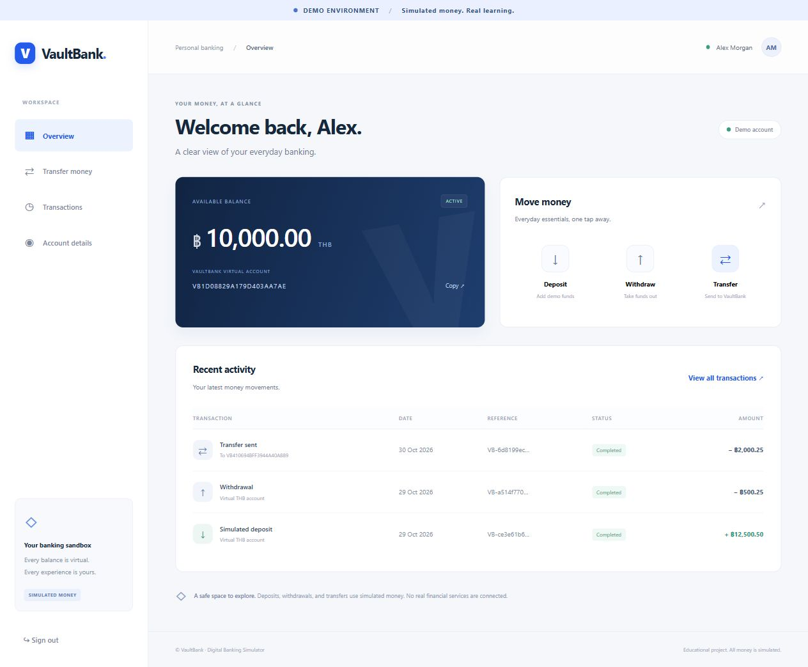
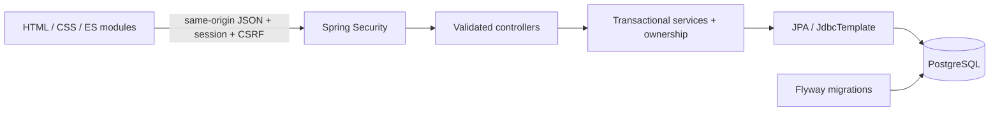

# NileBank — Digital Banking Simulator

A full-stack Java portfolio project demonstrating secure sessions, PostgreSQL transactions, explicit row locking, and retry-safe transfers through a responsive banking dashboard.

**Educational demo only. All money is simulated (THB, USD and EUR). NileBank is not a bank, does not connect to financial institutions, and cannot process real payments. Use fictional profile information and a demo password.**



## Features

- Register with a normalized unique email; sign in and out using server-side sessions.
- Create one virtual THB account, initially funded with zero.
- Deposit simulated money, withdraw within the available balance, and transfer to another NileBank account.
- Review a transfer before confirmation; replay the same idempotency key without moving funds again.
- View persisted recent activity, paginated history, and account/profile details.
- Responsive desktop/mobile layout, keyboard-accessible forms, visible demo notices, loading and error states.
- PostgreSQL constraints, Flyway migrations, explicit account row locks, and immutable successful-operation history.

## Exchange, demo banks and finance

- Real ECB reference rates fetched via Frankfurter on refresh, with dated 120-second THB/USD/EUR exchange quotes.
- Fictional partner-bank connections and atomic, idempotent simulated movements.
- Manual personal finance entries, category budgets, savings goals and explainable monthly spending insights.

See [extension guide and API](docs/EXTENSIONS.md) for a test walkthrough, rate freshness, consistency design and limitations.

## Stack

Java 21 · Spring Boot 3.5.16 · Maven 3.9.11 wrapper · Spring MVC/Data JPA/Security/Validation · Flyway · PostgreSQL 17 · HTML/CSS/vanilla JavaScript ES modules · JUnit 5/Mockito/Spring Boot Test/Testcontainers · Docker Compose.

## Run locally with Docker

Requires Git, Docker Desktop or Docker Engine with Compose, a running Linux container engine, internet access for the first image/dependency download and exchange rates, and a free localhost port 8080. Run the commands below from the repository root.

Clone the application branch (until its pull request is merged into main):

```bash
git clone --branch refactor/fullstack-monorepo https://github.com/Mr-San-Win/NileBank..git nilebank
cd nilebank
```

1. Copy the example configuration:

   ```bash
   cp .env.example .env
   ```

   PowerShell: `Copy-Item .env.example .env`.

2. Edit `.env` and replace `DB_PASSWORD` with a local demo database password. Keep `COOKIE_SECURE=false` for localhost HTTP. The file is ignored by Git.

3. Start:

   ```bash
   docker compose up --build
   ```

4. Open [http://localhost:8080](http://localhost:8080). Health: [http://localhost:8080/api/v1/health](http://localhost:8080/api/v1/health).

The application port binds to loopback only. PostgreSQL is available only on the Compose network. Database readiness gates application startup; application health queries PostgreSQL. A named volume preserves demo data across restarts. `docker compose down` stops the project while retaining the volume.

No preloaded login credentials exist. Register a fictional profile and create its virtual account. Add simulated funds, then create a second user/account (sign out first or use a separate browser profile) to demonstrate transfers. A normal second tab shares the same login cookie.

## Tests and development

Java 21 and Docker are required for the full suite. Node.js 20+ is needed for JavaScript syntax checks, and Python 3 for the optional HTTP smoke scripts. No frontend dependencies need installation. PostgreSQL integration tests are mandatory and fail if Docker is unavailable; they are not silently skipped.

```bash
cd backend
sh mvnw -B clean verify
cd ..
node --check frontend/app.js
node --check frontend/extensions.js
python3 scripts/smoke.py
python3 scripts/smoke_extensions.py
```

PowerShell: run `.\mvnw.cmd -B clean verify` inside `backend/`. An installed Maven can run `mvn -f backend/pom.xml clean verify` from the repository root. The smoke scripts require the Docker app to be running and create fictional persisted demo records.

Tests include registration, duplicate email, generic login errors, unauthenticated access, ownership, zero accounts, exact monetary validation, deposits/withdrawals, insufficient funds, immutable history, atomic transfers, idempotency replay/conflict, concurrent withdrawals, concurrent duplicate transfers, opposing transfers, mixed operations, CSRF rotation/logout, and a real HTTP session journey.

The GitHub Actions workflow runs PostgreSQL tests through the backend Maven wrapper, checks both frontend JavaScript modules and builds the single application image. Refactor verification results are documented in [the structural refactor guide](docs/REFACTOR.md).

Observed on 30 October 2026: Java 21 `mvn -B verify` passed **56 tests, 0 failures, 0 errors, 0 skipped**, and packaged the executable JAR. The Docker build/start and database/application health checks passed. Both `python3 scripts/smoke.py` and `python3 scripts/smoke_extensions.py` passed; the former verifies the complete HTTP banking journey against Docker, including idempotent replay and cross-user ownership rejection. Browser QA verified the actual frontend on desktop and at a 390px mobile breakpoint. These are functional checks, not a performance benchmark or independent security audit.

For host Java development, use an independently running PostgreSQL instance and set `DB_URL`, `DB_USER`, and `DB_PASSWORD` in the process environment, then run `mvn -f backend/pom.xml spring-boot:run`. Spring Boot does not automatically load the Compose `.env` file. Use a fresh empty database so Flyway can create the schema.

## Repository structure

```text
backend/
  pom.xml, mvnw, mvnw.cmd, .mvn/
  Dockerfile
  src/main/java/           Spring Boot application
  src/main/resources/     configuration and Flyway migrations
  src/test/java/          unit, HTTP and PostgreSQL concurrency tests
frontend/
  index.html, styles.css, app.js, extensions.js
docs/                     architecture, API, setup guides and screenshots
scripts/                  optional HTTP smoke checks
.github/workflows/        CI
compose.yaml              single application service plus PostgreSQL
```

Maven copies `frontend/` into `backend/target/classes/static/` during `process-resources`, without resource filtering. The executable JAR contains those assets under `BOOT-INF/classes/static/`. Source assets are maintained only in `frontend/`; generated copies are ignored. Run a clean build after renaming or deleting assets to discard old output. Keep both directories together when building.

Spring Boot serves the packaged frontend and `/api/v1` from the same origin, retaining session cookies, CSRF and security routing. Production requires no Node.js runtime or separate frontend server. The Docker build uses the repository root as its context and `backend/Dockerfile`.

## Architecture



Feature packages: `auth`, `user`, `account`, `transaction`, `transfer`, `exchange`, `partner`, `finance`, `config`, and `common`. Controllers handle HTTP; services enforce business rules and transaction boundaries; repositories persist entities; DTOs define external contracts. The application serves its own static frontend, so no CORS configuration or separate frontend server is needed.

## Database

- `app_users`: UUID, name, normalized unique email, BCrypt password hash, creation timestamp.
- `bank_accounts`: UUID, unique owner FK, generated unique account number, THB currency constraint, numeric(19,2) nonnegative balance, ACTIVE/FROZEN status, optimistic version, creation timestamp.
- `banking_transactions`: UUID, type/status, positive bounded numeric amount, source/destination FKs, unique reference, timestamp, sender-scoped idempotency key.
- currency_wallets and exchange_quotes: foreign balances, expiring agreed rates and replay-safe execution with source provenance.
- partner_connections and partner_movements: fictional bank balances, consent/state and scoped retry keys.
- finance_entries, finance_budgets, savings_goals: separate owner-scoped THB planning data.
- Flyway history and a small foundation metadata table track schema/application initialization.

Indexes support source/destination history by timestamp. A PostgreSQL trigger rejects updates/deletes to transaction rows. Successful operations are audited; rejected operations do not create financial history.

## Security

BCrypt strength 12; HTTP-only, SameSite=Lax session cookies; session ID rotation on login; CSRF on all POSTs, including login/registration; token rotation after login; logout invalidates the session. JSON errors hide stack traces, and response DTOs never expose password hashes. Backend services check account ownership and frozen status. CSP restricts scripts/styles to this origin, with framing blocked.

JavaScript fetches a masked CSRF token from `GET /api/v1/auth/csrf`, sends it in the returned header on state-changing requests, and fetches a fresh token after login. No authentication tokens or passwords are placed in localStorage. Browser text from the API is inserted through `textContent`.

For any deployment beyond this local demo, terminate HTTPS at a trusted proxy, set `COOKIE_SECURE=true`, configure proxy trust deliberately, and add operational and abuse controls. Local HTTP defaults are unsuitable for a public service.

## Consistency, locking and idempotency

Every monetary change locks its account row with PostgreSQL `SELECT … FOR UPDATE` semantics before checking/changing its balance. Transfers lock both account rows in the same UUID string order to reduce deadlock risk. Pre-lock transfer lookups return scalar IDs rather than managed entities to avoid reusing stale balances.

A service transaction debits, credits, inserts history and stores the idempotency key together. Exceptions roll all of them back. The locked source serializes same-sender requests; a unique `(source_id, idempotency_key)` constraint provides a database backstop. Matching retries return the original transaction; changed recipient/amount conflicts. Failed transfers roll back their key, so a corrected retry may reuse it.

Amounts are BigDecimal throughout the backend. JSON monetary responses use decimal strings so JavaScript cannot lose precision while parsing large balances. Requests accept decimal strings and enforce at most two fractional digits, positive values, and a 1,000,000 THB operation limit.

This is an account-balance simulator with append-only audit history, **not a production double-entry ledger**.

## API overview

All paths start with `/api/v1`. See [API documentation](docs/API.md) for bodies, CSRF, errors and retry semantics.

| Method | Path | Purpose |
| --- | --- | --- |
| GET | /health | Database-aware health |
| GET | /auth/csrf | Session-bound token/header |
| POST | /auth/register | Register profile |
| POST | /auth/login | Create authenticated session |
| GET | /auth/me | Current profile |
| POST | /auth/logout | Invalidate session |
| POST | /accounts | Create virtual account |
| GET | /accounts/me | Own account and balance |
| POST | /transactions/deposit | Simulated deposit |
| POST | /transactions/withdraw | Withdrawal |
| POST | /transfers | Atomic idempotent transfer |
| GET | /transactions?page=0&size=10 | Own paginated history |

## Screenshots and demo

Screenshots were captured from the running app using fictional users and persisted simulated transactions. [Currency exchange](docs/screenshots/currency-exchange.png) · [Finance tracker](docs/screenshots/finance-tracker.png). [Mobile dashboard](docs/screenshots/dashboard-mobile.jpg). Follow [DEMO](docs/DEMO.md) for a step-by-step walkthrough.

## Limitations and future improvements

One primary THB account with USD/EUR exchange wallets. Ordinary withdrawals and account-to-account transfers use THB. No password reset, email verification, MFA, rate limiting, admin UI, or self-service freeze action. Frozen state is enforced in the backend and integration tests. Sessions live in application memory and expire on restart. The UI keeps a pending transfer key in tab memory: after a reload or uncertain response, inspect history before starting a fresh transfer. Deposits/withdrawals do not have idempotency keys; an ambiguous response must be checked before retrying.

History contains successful financial operations only. The database owner could alter/disable its trigger; it is not an externally tamper-proof ledger. No independent security audit or performance benchmarks have been performed. No public deployment or real payment integrations exist.

Potential improvements: rate limits and authentication abuse monitoring, recovery/MFA, stronger operational observability, more browser automation, an independently designed ledger, and reconciliation. Keep these separate from the simulator's educational claims.

## Further reading

[Architecture](docs/ARCHITECTURE.md) · [API](docs/API.md)

## Author

**San Win**  
Software Engineering Student — KMITL, Thailand

