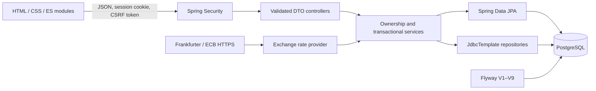

# NileBank architecture

NileBank is an educational banking simulator. All funds are virtual. Real public exchange-rate data is used only to price simulated conversions; there are no real bank connections or payments.

## Layers and request flow

Feature packages are auth, user, account, transaction, transfer, exchange, partner, finance, config and common. Controllers translate HTTP and validate DTOs. Services enforce ownership, eligibility and monetary rules and define transaction boundaries. Repositories persist records. API responses use DTOs and decimal strings, never password hashes or entity serialization. A single application serves the frontend and APIs, avoiding a separate frontend server and CORS configuration.

## Database model

| Table | Purpose and principal constraints |
| --- | --- |
| app_users | UUID, full name, normalized unique email, BCrypt hash, timestamp |
| bank_accounts | One unique owner FK, unique generated number, THB, nonnegative numeric(19,2) balance, ACTIVE/FROZEN status, version |
| banking_transactions | Immutable successful deposit, withdrawal, transfer, exchange and fictional-bank audit records; account FKs, unique reference, currency/counter-amount and shape constraints |
| currency_wallets | USD/EUR balances uniquely scoped to the parent account, nonnegative fixed-precision amounts |
| exchange_quotes | Owner/account, source and destination currencies, amounts, applied rate, provider/publication/fetch metadata, expiry and executed transaction reference |
| partner_connections | Allowlisted fictional bank, own parent account, connection state and simulated THB balance; reconnect preserves funds |
| partner_movements | Account-scoped unique client key, exact request parameters, transaction and original balance snapshots |
| finance_entries | Owner-scoped manual income/expense amount, category, description and date |
| finance_budgets | Unique owner/month/expense-category limit |
| savings_goals | Owner, target and bounded saved planning amount |

Flyway versions schema changes; Hibernate validates rather than creates it. V1–V6 establish foundation, users, banking, transfer idempotency, append-only history and product metadata. V7–V9 add exchange, partners and finance without rewriting old migrations. Foreign keys, check constraints and uniqueness protect relational invariants. History indexes support account/time queries. A PostgreSQL trigger rejects audit updates/deletes; a privileged database owner could disable it.

## Authentication and browser security

BCrypt strength 12 hashes passwords. Spring Security authenticates normalized email and stores the UUID principal in an HTTP session. JSON login applies session fixation and CSRF authentication strategies and saves the SecurityContext. Logout invalidates the session and removes its cookie.

Cookies are HTTP-only and SameSite=Lax. Secure cookies are configurable for local HTTP and required with HTTPS outside local development. GET /api/v1/auth/csrf supplies a masked session token and header name; the frontend includes it on mutations and obtains a fresh token after login. Registration/login also require CSRF. APIs return uniform errors without stack traces. Services enforce ownership even when invoked outside controllers. CSP restricts scripts/styles to the origin and blocks framing. Browser code renders API text with textContent and stores no authentication secrets in localStorage.

## Money, transactions and locking

Java BigDecimal and PostgreSQL numeric(19,2) represent balances. Amounts must be positive, within the operation limit and have at most two decimals before persistence. Foreign-exchange applied rates use higher precision, and received funds round down to two decimals.

A service transaction groups balances, successful history and retry state. An unchecked business/persistence exception rolls back the whole operation. @Transactional alone does not prevent overspending: every monetary mutation first acquires a pessimistic write lock on its parent bank_accounts row. Ordinary account-to-account transfers lock both account UUIDs in deterministic string order, reducing deadlock risk. Scalar pre-lock account lookups avoid reusing stale managed entities. The version column is an additional safeguard, not the primary concurrency mechanism.

Exchange and partner JDBC repositories join the same Spring JpaTransactionManager/DataSource transaction and obey the same parent-account lock as JPA operations. This serializes competing wallet conversions, withdrawals, partner movements and transfers for that account. PostgreSQL READ COMMITTED plus this explicit protocol provides the intended consistency. Lock conflicts are reported; deterministic ordering does not guarantee that deadlocks are impossible.

Deposits/withdrawals lock, validate owner/status/amount/funds, change balance and append history. There is no direct balance-edit endpoint. Failed operations create no successful audit entry. Savings allocations lock their goal row to prevent concurrent requests exceeding its target; they never reserve banking funds.

## Atomic transfers and idempotency

NileBank transfers validate different existing accounts, source ownership, both statuses and funds, then debit/credit/history/key commit together. Client keys are sender-scoped with a database unique constraint. The account lock serializes competing same-sender requests. A matching replay returns the original result; changing recipient or amount under that key returns a conflict. A failed transaction rolls back its key and can be retried.

Partner movements similarly compare connection, direction and amount under an account-scoped key and return stored original snapshots. Fictional partner balances and NileBank balances update atomically. Initial simulated funds are granted only once per connection; reconnecting cannot reseed them. Quotes use their persisted UUID as the one-time execution identity.

Deposits/withdrawals and manual tracker additions do not have idempotency keys. After an ambiguous network response, inspect history/entries before retrying them. Client pending keys live in tab memory; after reload, inspect history before beginning a fresh operation.

## Foreign exchange flow

1. Refresh and quote creation request Frankfurter v2 ECB EUR-base THB/USD data over HTTPS. Only currency parameters are sent, not user information.
2. The provider validates response shape, currencies, positive rates, common publication date and a maximum seven-day age. Timeouts or invalid/unavailable data reject new quotes with HTTP 503; no fixed fallback exists.
3. The service derives THB/USD/EUR cross-rates, validates the pair/amount and persists a 120-second quote with applied rate, received amount, source, publication date and retrieval time. The network fetch occurs before acquiring the monetary account lock.
4. Confirmation locks the owning account, checks eligibility, expiry and available funds, debits one wallet, credits the other, appends history and marks execution in one transaction.
5. Repeating an executed quote returns the original result without converting again.

Reference rates are published daily, not on every market tick. A refresh can return unchanged values on the same day or a holiday. Existing valid quotes retain their agreed rate. Only exchange uses foreign wallets; ordinary deposits, withdrawals, transfers and partners use THB.

## Finance analysis

Manual THB records remain separate from banking history: moving money is not automatically income or consumption. A repeatable-read monthly summary derives income, expenses, net flow, savings rate, category spending/budget comparisons and previous-month expenses. Missing income yields no invented savings percentage. Insights are explainable arithmetic and budgeting prompts, not a prediction model or financial advice. Savings allocations are planning records; unrecorded obligations and unequal month lengths limit the analysis.

## Runtime, testing and tradeoffs

Compose supplies PostgreSQL readiness, a persistent volume and a non-root Java runtime. The app binds to loopback, and the database has no published port. Configuration uses environment variables; .env is ignored. Sessions are in memory and expire on app restart; persisted balances/history survive.

JUnit/Spring Boot/Testcontainers tests run on actual PostgreSQL. Concurrent tests use separate service transactions and synchronized starts to exercise overspending, opposing/mixed transfers, replay and goal allocation. HTTP tests verify sessions, CSRF and ownership; separate smoke scripts and browser checks exercise the real app. Provider fixtures make unit/integration tests deterministic, while the live smoke check verifies public rate retrieval.

This is a layered monolith with account balances and immutable audit history, not a production double-entry financial ledger. It intentionally omits real payments, KYC, recovery/MFA, rate limiting, reconciliation, fraud controls and operational banking guarantees. See EXTENSIONS.md for APIs.

## Source layout and build

`backend/` owns Maven, Java, configuration, Flyway migrations, tests and the application Dockerfile. `frontend/` owns the unmodified HTML/CSS/ES modules. Maven resources configuration packages the sibling frontend directory into the classpath static directory, so both the packaged JAR and test server expose the same URLs as before. No generated assets are checked in. Root Compose builds with context `.` and Dockerfile `backend/Dockerfile`; the image is still one non-root Java service. CI runs a clean backend build, frontend syntax checks and the root-context image build. This refactor changes paths and packaging only; APIs, schema contents, session/CSRF behavior and transaction logic are unchanged.
