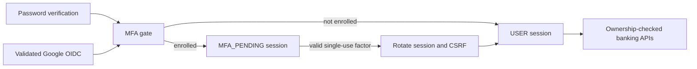

# Optional authenticator MFA

TOTP enrollment is disabled by default and requires an operator-supplied encryption
key ring. Existing enrolled users still require MFA when enrollment is disabled.
Missing keys fail closed for their sign-ins; the feature flag never bypasses a factor.
NileBank remains an educational simulator, not a production authentication service.

## Authentication and authorization

A successful password or validated Google primary sign-in passes through the same
MFA gate. An enrolled profile receives only `ROLE_MFA_PENDING`, not `ROLE_USER`.
Protected APIs require `ROLE_USER`, so primary authentication alone cannot expose
profiles/balances or perform financial mutations. The pending step is session-bound,
expires after five minutes and permits at most five attempts. It is never accepted
from a client-supplied identity or flag.

Password login returns 202 `{ "mfaRequired": true }` for enrolled users instead of
a user profile. Google still redirects to `/`; the browser checks the public
`GET /api/v1/auth/mfa/status` before requesting a profile. The OAuth filter overwrites
Authentication.details, so pending OIDC state lives in a restricted principal wrapper
that preserves validated OIDC claims and the internal UUID. The server retains the
original authentication; it never sends Google tokens to JavaScript.

`POST /api/v1/auth/mfa/challenge` takes `{ "code": "..." }` with CSRF. Successful
verification restores the original full authentication, rotates the session ID,
clears the old CSRF token and returns the normal profile. The frontend refreshes
CSRF before protected actions. Logout clears either a full or pending session.
Credential-version changes and pending expiry are enforced on subsequent requests.

## Enrollment and management

Authenticated security routes require full USER authority and CSRF:

- `GET /auth/security/mfa`: available/enabled and remaining recovery-code count.
- `POST /auth/security/mfa/enroll`: currentPassword; creates a ten-minute pending
  seed and returns a manual authenticator setup key once for that attempt.
- `POST /auth/security/mfa/confirm`: currentPassword and a fresh authenticator code;
  activates the factor and returns eight recovery codes once.
- `POST /auth/security/mfa/disable`: currentPassword plus a new factor/recovery code,
  or a server-recorded MFA verification in this session within five minutes.
- `POST /auth/security/mfa/recovery-codes`: the same proof; replaces all old codes.

Enabling, disabling and code replacement increment credential version and sign out
the caller. Other sessions fail on their next request. Newly generated recovery
codes are shown in a separate one-time dialog after sign-out, then cleared from DOM
when closed. Setup keys, passwords and codes never enter localStorage/sessionStorage.
Wait for a different TOTP after enrollment: its confirmation code cannot be replayed.
A recent server-side MFA stamp lets a user who just consumed their last recovery code
manage the factor with fresh password proof; expired/wrong-owner/version stamps fail.

Enrollment requires a current local password, or for Google-only profiles an explicit
recent same-identity Google verification. No password is fabricated. See
[Google reauthentication](GOOGLE_REAUTHENTICATION.md) for required provider configuration. Once a password profile has MFA, linked
Google sign-in also requires it. Password/email recovery changes only the password;
it does not remove MFA or bypass its next sign-in challenge. There is no support or
email shortcut for a lost factor. Retain your authenticator and offline recovery codes.

## Cryptography and persistence

V17 adds `mfa_settings` and `mfa_recovery_codes` without modifying earlier migrations
or financial tables. Every factor operation locks the internal user first. TOTP uses
RFC 6238/HOTP, HMAC-SHA1, a random 160-bit seed, six digits, 30-second steps and at
most one adjacent step of clock tolerance. A persisted monotonic last counter rejects
successful-code replay, including concurrent attempts. Keep server clocks synchronized.
TOTP is susceptible to phishing/relay; it is not a phishing-resistant passkey.

Seeds are encrypted using AES-256-GCM, a fresh 96-bit nonce and a 128-bit tag.
Authenticated additional data binds ciphertext to the user UUID, key ID and format
version. Copying another user's ciphertext or modifying it fails authentication.
Only ciphertext/key ID are stored in PostgreSQL; encryption keys stay outside it.
Each recovery code has 128 random bits, is owner-scoped and stored as a SHA-256 hash.
Successful consumption is atomic and single-use. Raw recovery codes cannot be read
back from the database. Disabling a factor deletes its authentication metadata only;
it never deletes a profile, bank account or financial history.

Invalid codes increment a committed database counter even though the API rejects the
request. Ten failures per profile in a 60-second window block further attempts until
the window expires; a new browser session does not reset it. Existing IP limits also
apply. This does not replace distributed ingress abuse controls or security monitoring.
Events log allowlisted names and UUIDs, never seeds/codes/passwords/claims.

## Key configuration and rotation

- `MFA_ENABLED=false` by default controls new enrollment.
- `MFA_KEYS_JSON` is a protected JSON object mapping key IDs to Base64-encoded
  **32-byte random keys**. Maximum eight entries; duplicate/invalid entries fail startup.
- `MFA_ACTIVE_KEY_ID` selects the key for new seeds. It must exist in the key ring.

The example environment contains blanks only. Generate/store real keys outside Git
and chat, preferably in an operator-managed secret store. Never use the published
unit-test key or a human password as an encryption key. Changing the active ID does
not automatically re-encrypt existing seeds: keep their previous IDs/keys available.
To rotate, add a new key, select it for new enrollment, retain old keys until a reviewed
rewrap/re-enrollment process has migrated every old record, and rehearse rollback.

Before changing secrets, inspect actual key IDs with a restricted database session:
`SELECT DISTINCT key_id FROM mfa_settings;` (do not select ciphertext/seeds). Verify
every stored ID exists in the configured key ring. Back up keys securely and separately
from encrypted database backups; losing both authenticator access and keys can lock
users out. Database health alone does not verify key availability. No automatic key
provisioning, paid KMS or public deployment was performed.

## Verification and remaining limits

Tests include RFC vectors, Base32 round trips, owner-bound encryption/tamper rejection,
strict key configuration and rotation, real PostgreSQL OTP/recovery-code replay and
concurrency, pending financial API denial, expiry/limits, CSRF/session rotation/logout,
password recovery preserving MFA, management proof and a real signed OIDC callback.
The isolated browser script exercises manual setup, confirmation, replay rejection,
TOTP login, recovery-code replacement/login and protected disable. See the testing
and implementation-status documents for actual completed-run totals.

No authenticator push, WebAuthn/passkeys, factor-change email alerts or assisted
lost-all-factors recovery is implemented. All authentication sessions
remain in memory. No independent security audit or public environment verification
has been performed.

References: [RFC 6238](https://www.rfc-editor.org/rfc/rfc6238) and
[OWASP MFA guidance](https://cheatsheetseries.owasp.org/cheatsheets/Multifactor_Authentication_Cheat_Sheet.html).
